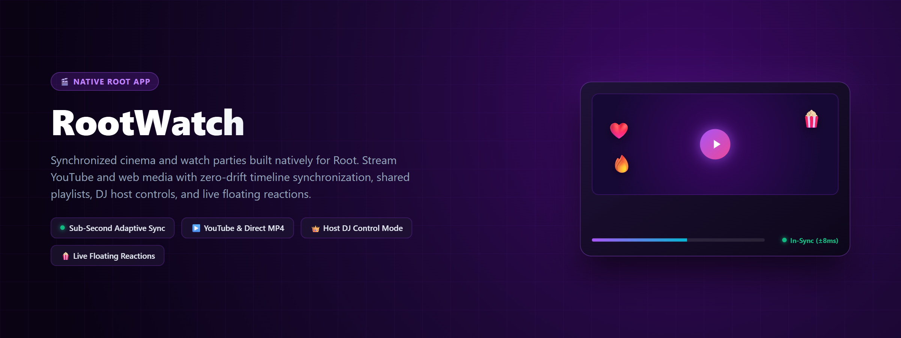
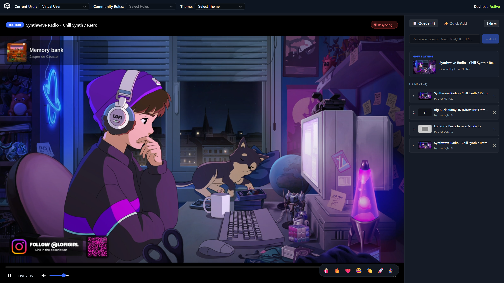
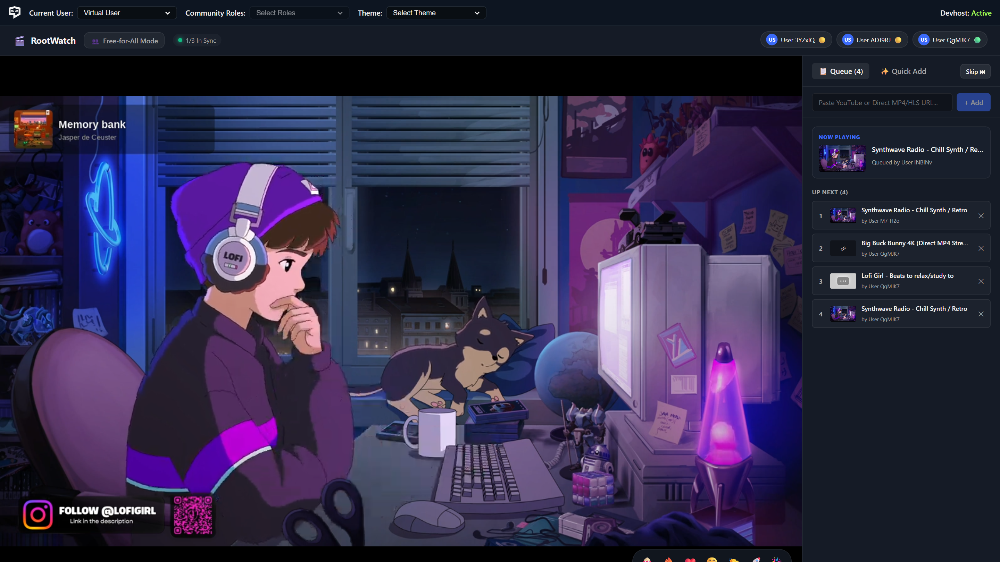
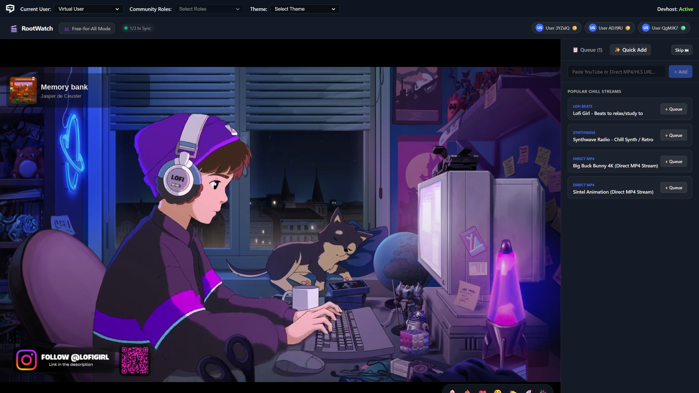
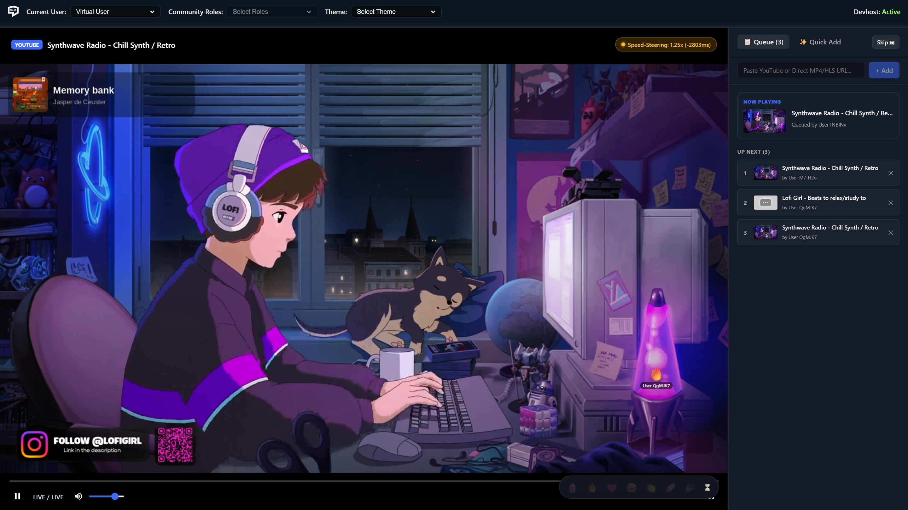

# 🎬 RootWatch

<div align="center">



**Synchronized Cinema & Watch Parties Built Natively for Root Communities**

[](https://dev.rootapp.com)
[]()
[]()
[]()

*Watch YouTube videos, live broadcasts, and direct web media together with sub-second adaptive timeline synchronization, collaborative playlists, host DJ controls, and live floating reactions.*

</div>

---

## ✨ Features

- **⚡ Sub-Second Adaptive Sync Engine:** Proprietary virtual server timeline with client-side clock drift compensation and rate steering (±0.05x). Keeps all viewers frame-accurate down to the millisecond without awkward pauses.
- **🎥 Multi-Source Media Player:** Stream YouTube videos, live streams, and direct MP4/HLS streams with native custom cinema player controls.
- **📋 Collaborative Queue & Quick Add:** Community-curated playlist queue with instant 1-click popular presets (Lofi Girl, Synthwave, 4K Open Movies) and direct URL queueing.
- **👑 DJ Mode & Host Controls:** Toggle between Free-for-All casual hangout mode or lock playback to Host-Only for scheduled community movie nights.
- **🍿 Live Floating Reactions:** Ephemeral, real-time floating emoji particles (🔥, 🍿, ❤️, 👏, 🎉) with participant badges and spam-limiting cooldowns.
- **👥 Spectator Presence & Sync Health:** Real-time participant status indicators showing connected members and their individual synchronization states (`🟢 In-Sync`, `🟡 Steering`, `🔄 Buffering`).

---

## 📸 Screenshots

| Cinema Experience | Interactive Queue Drawer |
|:---:|:---:|
|  |  |

| Quick Add Presets | Live Floating Reactions |
|:---:|:---:|
|  |  |

---

## 🏗️ Architecture & Technology

RootWatch is architected as a native package for the **Root Application SDK**:

```
rootwatch/
├── networking/        # Protobuf definitions & generated TypeScript RPC interfaces
│   └── proto/         # watch_party.proto (Real-time sync contracts)
├── server/            # Node.js backend running on Root DevHost / Microservice
│   └── src/           # State management, DJ permissions, timeline scheduler
└── client/            # React 18 frontend rendered inside Root Native Desktop/Web
    └── src/           # Cinema canvas, sync engine hook, reactions overlay
```

### Key Libraries
- **Frontend:** React 18, TypeScript, Vite, CSS Modules / Modern CSS Variables
- **Backend:** Node.js, TypeScript, Root App SDK (`@rootsdk/server-app`)
- **Networking:** Protobuf binary serialization over high-speed WebSocket channels

---

## 🚀 Development & Build

### Prerequisites
- Node.js >= 22
- Root App SDK Dev Tools (`@rootsdk/dev-tools`)

### Commands
```bash
# Install workspace dependencies
npm install

# Build all packages (networking proto, server, client)
npm run build

# Start local DevHost for testing in your Root staging community
npm run server  # (in server/)
npm run client  # (in client/)

# Package for production release
npx rootsdk build package --output-file ./rootapp.pkg --project-folder .

# Upload to Root Developer Portal
npx rootsdk upload package --file ./rootapp.pkg --authToken <AUTH_TOKEN> --host dev.rootapp.com
```

---

## 🔒 Privacy & Compliance

RootWatch is built privacy-first:
- Zero personal data collection, cookies, or external tracking.
- Session timestamps and participant IDs are handled transiently in-memory solely for real-time synchronization.
- Read our full [Privacy Policy](https://gist.github.com/pvpmurders/085114685a899cd84bf218e6bc5b55ca).

---

## 📄 License

This project is licensed under the MIT License.
